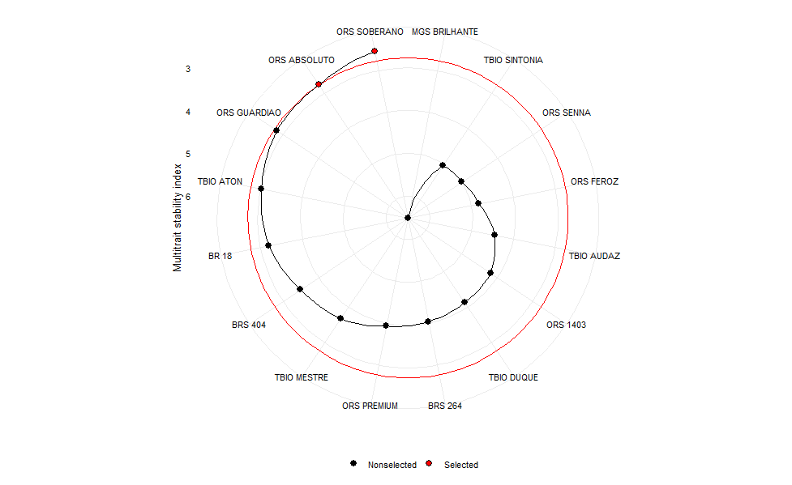

# 🌾 Adaptability and Stability of Rainfed Wheat Cultivars in Minas Gerais


Analysis code from my **MSc dissertation in Genetics and Plant Breeding** (UFLA). It evaluates **16 wheat cultivars** grown under rainfed conditions in **9 environments** (5 locations in southern Minas Gerais, Brazil × 2 seasons, 2022–2023). The traits are grain yield (PROD), plant height (ALT), hectoliter weight (PH), thousand-kernel weight (PMS) and the IPPH index.



## Analytical pipeline

**1. Spatial two-stage analysis** (`scripts/01 Rotina_Espacial_Two_stage_analysis*.R`)
- **Stage 1 (per environment):** linear mixed models fitted with `asreml`, comparing three models: (m0) the lattice design with incomplete blocks, (m1) row + column random effects, and (m2) a separable AR1(row) ⊗ AR1(column) spatial residual. The best model is chosen by BIC with `icREML`, and the relative efficiency of each model versus the lattice is reported. Adjusted means are saved for each trait × environment.
- **Stage 2 (joint analysis):** genotype, environment and G×E means across the 9 environments.

**2. Adaptability and stability** (`scripts/02 Rotina_Estabilidade_Metan.R`)
- **GGE biplots** (`metan`): which-won-where, mean vs. stability, discriminativeness vs. representativeness, environment and genotype ranking.
- **Annicchiarico** reliability index, including comparisons with the check cultivars BRS 264 and TBIO Aton.
- **Scott-Knott** clustering of cultivar means.
- **MTSI** (Multi-Trait Stability Index) to select cultivars that combine performance and stability across all traits.

## Repository structure

```text
Adaptability_Stability_Wheat/
├── data/                  # field trial data (Excel)
├── scripts/
│   ├── 01 Rotina_Espacial_Two_stage_analysis.R       # stage 1 + 2, all traits
│   ├── 01 Rotina_Espacial_Two_stage_analysis_IPPH.R  # same pipeline for IPPH
│   ├── 02 Rotina_Estabilidade_Metan.R                # GGE, Annicchiarico, Scott-Knott, MTSI
│   └── exploratory/       # earlier model tests
├── R/                     # helper functions (icREML, Scott-Knott, Annicchiarico)
├── output/
│   ├── tables/            # adjusted means per environment, G, E and G×E tables
│   └── figures/           # biplots, Annicchiarico plots, MTSI (TIFF/PDF/PNG)
├── reports/               # analysis reports (Portuguese)
└── Mestrado_Ricardo.Rproj
```

## How to run

1. Open `Mestrado_Ricardo.Rproj` in RStudio. All paths are relative to the project root.
2. Install the packages: `metan`, `lme4`, `emmeans`, `readxl`, `rio`, `tidyr`, `stringr`, `ggplot2`, `fmsb`, `asremlPlus`.
3. Run `scripts/01 ...` and then `scripts/02 ...`.

> ⚠️ Stage 1 requires **ASReml-R**, which is commercial software that needs a license. The stability analyses in `02` run with free packages from the tables already provided in `output/tables/`.

Code comments and reports are in Portuguese.

## Related work

The same dataset is reanalyzed with **Bayesian hierarchical models and Information Theory** in [LCF5900_Wheat-Bayesian-Infotheory_Breeding](https://github.com/raruizc/LCF5900_Wheat-Bayesian-Infotheory_Breeding).

## Credits

- `R/icREML.R`: AIC/BIC for ASReml models, from Verbyla, A. P. (2019). A note on model selection using information criteria for general linear models estimated using REML. *Aust. N. Z. J. Stat.* 61(1), 39–50.
- `R/annicchiarico/`: Annicchiarico method routine shared in a UFLA graduate course (authors credited in the file header).
- `R/sk.R`: Scott-Knott test function.

**Author:** Ricardo Antonio Ruiz-Cardozo. My own code is released under the [MIT License](LICENSE). Third-party functions and data keep their original authorship.
